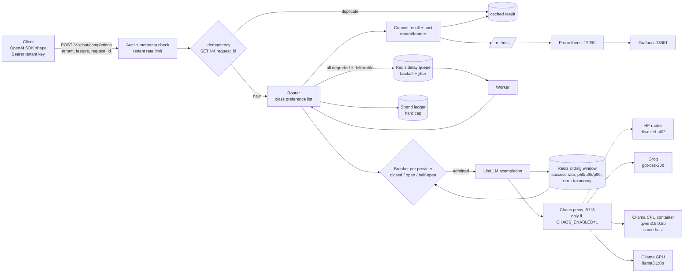

# Self-Healing LLM Gateway

An OpenAI-compatible LLM gateway with per-provider circuit breakers, automatic failover, hedging, a deferrable retry queue and per-tenant cost attribution. In a measured chaos run where **both local model runtimes went down for 90 s, clients still got answers for 83.9% of requests (80.0% of interactive ones) by failing over to Groq**, the only independent external provider. A Groq free-tier rate limit capped that number (details below). All four runs together produced **0 duplicate side effects across 141 duplicate submissions**.

> Local docker compose only. Cloud IaC is not built yet.

## Results (real runs, raw data in `results/`)

Four chaos runs used the same gateway, a Poisson load generator, real providers and the chaos proxy. Every row below comes from `results/summary.json`, which `scripts/analyze.py` builds from the raw per-request files (`results/*_run.json`).

**Read the failure domains before the numbers.** `ollama` (llama3.1:8b on the host GPU) and `ollama_cpu` (qwen2.5:0.5b in a Docker container on the same laptop) are two runtimes on **one host**. They are **not** independent failure domains: a power, network or host failure takes out both. The only independent provider that worked during these runs was **Groq** (`openai/gpt-oss-20b`). The Hugging Face router was the planned third provider, but this account returns HTTP 402 "no remaining credits" (see [What did not work](#what-did-not-work)). Only run D below measures availability across independent failure domains.

| run | fault injected (via chaos proxy) | window | requests | client availability | interactive availability | interactive p95 |
|---|---|---|---|---|---|---|
| **D. local host down** (`local_host_outage_run.json`) | `ollama` + `ollama_cpu` return 100% HTTP 503 for 90 s; Groq is the only fallback; 0.7 rps | baseline | 37 | 100% | 100% | 2832 ms |
| | | **during outage** | 56 | **83.93%** | **80.0%** | 2357 ms |
| | | after fault cleared, breakers still open | 27 | 33.33% | 21.74% | 1916 ms |
| | | after breakers closed | 58 | 98.28% | 97.87% | 8937 ms |
| A. GPU runtime down (`chaos_run.json`) | `ollama` 100% 503 for 120 s; same-host CPU fallback (not independent); 1 rps | baseline | 110 | 99.09% | 98.88% | 679 ms |
| | | during outage | 122 | 100% | 100% | 2330 ms |
| | | after fault cleared, breaker still open | 37 | 100% | 100% | 1817 ms |
| | | after breaker closed | 100 | 100% | 100% | 2899 ms |
| B. GPU brownout (`brownout_run.json`) | `ollama` +7000 ms latency, 0% errors, 120 s; 1 rps | during brownout | 114 | 100% | 100% | 2658 ms |
| C. everything down (`total_outage_run.json`) | `ollama` + `ollama_cpu` + `groq` 100% 503 for 60 s; 1 rps | during outage | 46 | 23.91% (all deferred work) | **0%** (fails fast, by design) | n/a |
| | | after fault cleared, breakers still open | 25 | 60.0% | 54.55% | 2351 ms |

Breaker timelines (seconds from the start of the fault, taken from the gateway's own transition log):

* **A (error outage):** `ollama` tripped on error rate at **+17.2 s**. Half-open probes failed at +31.9, +52.1, +84.4 and +118.1 s, with the cooldown doubling up to its 30 s cap. The fault cleared at +120 s, and the breaker **closed at +163.4 s, 43.4 s after recovery**, once 3 consecutive probes succeeded. 137 failover events in total.
* **B (brownout):** `ollama` tripped on **p95 over budget** at +14.2 s. Half-open probes were rejected as `probe_too_slow` twice, and the breaker closed **7.3 s** after the latency cleared.
* **C (everything down):** all three breakers opened within 6 s. Interactive requests failed fast with HTTP 503: the gateway never calls a provider whose breaker is open. **All 11 deferrable requests submitted during the outage were queued (HTTP 202) and completed after recovery**, the slowest after 75.9 s, through exponential backoff with jitter. This is the intended behaviour, not a failure.
* **D (local host down):** `ollama_cpu` tripped at +1.9 s and `ollama` at +15.1 s, and traffic moved to Groq (47 requests served by Groq during the outage). Groq then started returning **429s**, because its 8K tokens/min free-tier limit is shared with other projects on the same key. Groq's breaker opened at +97.5 s on `rate_limit`, which caused the 33% window right after the fault cleared. The `ollama` breaker closed 38 s after recovery (`ollama_cpu` at 63 s).

**Idempotency:** 141 duplicate submissions across the four runs: client retries after a success, plus 3% sent concurrently with the original. 136 got the identical cached completion. The other 5 were all in run C (everything down):
* 2 got a `202 queued` replay.
* 2 got a `409` conflict (original still in flight, or failed and released).
* 1 got a `503` because the original also failed.

**0 `request_id`s were committed more than once**, per the gateway's per-request commit counters (`/admin/side-effects`).

**Cost of the measurement runs:** $0.0058 total for this project, from the shared ledger (190 paid calls at list price, including 3 cancelled hedge losers charged worst-case). That is under the project's $1 cap.

### Dashboard screenshots (real, taken by `scripts/grafana_screenshot.py` during the runs)

| run A during outage | run A full window (taken after the run) |
|---|---|
|  |  |

More: `docs/grafana_brownout_during.png`, `docs/grafana_total_outage_during.png`, `docs/grafana_local_host_outage_during.png`.

**Demo video: TODO (human): record 90s demo.** Shot list:
1. (0-10 s) Grafana board, healthy: RPS mostly `ollama`, a thin `groq` line, all breakers green.
2. (10-20 s) Run `scripts/loadgen.py --provider ollama,ollama_cpu ...` and show the chaos proxy `PUT /admin/faults/...` call.
3. (20-40 s) Error-rate spike, breakers turn red, the failover bars fill, RPS moves to `groq`.
4. (40-55 s) The `groq` 429s appear in the error taxonomy panel. Explain the shared rate limit.
5. (55-75 s) Clear the fault: breakers go yellow (half-open probes), then green. RPS moves back to local.
6. (75-90 s) Terminal shows the loadgen headline: availability, failovers, 0 duplicate side effects.

### Resume line (filled from the runs above)
Built an LLM gateway with per-provider circuit breaking and automatic failover; sustained 83.9% client availability (80.0% interactive) through a 90-second outage of every local model runtime, failing over to an external provider, with 0 duplicate side effects across 141 retried requests and per-tenant/per-feature cost attribution.

## Architecture



* **Request classes** (`config/gateway.yaml`):
  * `classify`: interactive and hedged. Prefers `ollama` → `ollama_cpu` → `groq` → `hf`, and fires a hedge on the next provider after 2.5 s.
  * `generate`: interactive. Prefers `groq` → `ollama` → `ollama_cpu`.
  * `batch`: deferrable. Prefers local first, then the external providers.
* **Breaker rules:**
  * Trip when the error rate is ≥ 50% over ≥ 4 samples, or the p95 of successes exceeds the provider's latency budget. Only samples since the last state change count.
  * The first open lasts 10 s. Each failed probe doubles it, up to a 30 s cap.
  * Half-open admits 20% of eligible traffic, with at most 2 probes in flight. 3 consecutive fast successes close the breaker.
  * `content_filter`, `bad_request` and local budget refusals never trip a breaker, because they say nothing about provider health.
* **Error taxonomy:** `rate_limit`, `timeout`, `server_error`, `content_filter`, `auth`, plus `connection`, `bad_request`, `budget` and `other`. Classification checks the HTTP status before the exception class: LiteLLM 1.105.1 raises `BadRequestError` with `status_code=401` for a bad Groq key, and a plain `APIError(402)` for HF billing failures (`tests/test_components.py::test_status_code_beats_exception_class`).

## Design decisions (trade-offs)

1. **Provider #3: the HF router could not be used, so a second local runtime took its place, and it is not independent.**
   * **Gave up:** a third independent failure domain. Only Groq is external and working, so the independent-domain claim rests on run D alone, and `ollama` + `ollama_cpu` are never counted as two independent providers.
   * **Kept:** a third runtime that is separate at the process, VM and hardware level (GPU vs CPU). That is enough to exercise failover, hedging and recovery cheaply and repeatably.
   * **To fix:** add credits to HF (or another external provider) and set `HF_ENABLED=1`. The adapter and its 402 → `auth` mapping are already wired in.
2. **Traffic mix is mostly local, with a low paid rate.** About 90% of traffic prefers Ollama; `generate` (about 10%) prefers Groq. Load tests use 4-24 `max_tokens` and SST-2 one-liners (`scripts/prompts/sst2_validation_100.jsonl`, 100 real validation sentences).
   * **Gain:** all four runs cost $0.0058.
   * **Price:** the external fallback is a free-tier key shared with other projects. Run D shows it cannot absorb the full local load (429s at about 0.7 rps of gpt-oss traffic).
3. **Hedging only for `classify`, with a 2.5 s delay and a 30 hedges/min budget.**
   * **Cost:** hedging roughly doubles cost on every hedged call. The cancelled loser may still be billed, so a paid loser is written to the ledger at its worst-case estimate.
   * **Gain:** a slow primary no longer dominates tail latency.
   * **Finding:** the 2.5 s delay was too conservative. After recovery, hedged requests took about 2.6 s even though the hedge itself answered in about 100 ms. A delay near the primary's p95 (about 0.7-1.0 s at baseline) would cut the tail.
4. **Breaker state and health live in Redis, not in process memory.**
   * **Gain:** a gateway restart keeps the provider-health view (`test_window_survives_new_tracker_instance`).
   * **Price:** each attempt costs a Redis round trip, and transitions use per-process locks only. Multiple gateway workers would need a Lua or WATCH-based transition to avoid races (not built).

## What did not work

* **Hugging Face Inference Providers:** every model and provider returned **HTTP 402 "no remaining credits"** for this non-PRO account (`results/hf_router_probe.json`). HF is configured but disabled by default (`HF_ENABLED`). Because of this, the gateway has one independent external provider instead of two, and the second local runtime (`ollama_cpu`) is a stand-in that shares the host's failure domain.
* **The shared Groq free tier limited failover capacity.** In run D, Groq served 47 requests during the outage and then hit 429s. Its breaker tripped on `rate_limit`, leaving nothing healthy for about 30 s right after the local fault cleared (33% availability in that window).
* **Recovery lag is a real cost.** Exponential probe cooldowns protect a sick provider, but they also keep healthy capacity unused after it recovers. In A the breaker closed 43 s after recovery. In C, 40-45% of requests failed in the window after the fault cleared but before breakers re-closed. Half-open probes come only from live traffic, so a fallback-only provider (`ollama_cpu` in C) can stay half-open indefinitely.
* **The host GPU Ollama is noisy.** Baseline p95 ranged from 0.68 s to 2.8 s between runs, and in runs C and D the `ollama` breaker tripped on p95 *before* any fault was injected (recorded as `breaker_trips_before_fault` in `results/summary.json`). Other workloads share the 6 GB GPU. The breaker did its job; the latency budget (6 s) may be too tight for this host.
* **One client `ReadError` in run A's baseline.** This is the classic keep-alive race: uvicorn's default 5 s keep-alive is shorter than an idle pooled client connection. It is now fixed (`timeout_keep_alive=75`); runs B-D used the fix.
* **The first total-outage attempt crashed** because the load generator started before the gateway finished importing LiteLLM. It now waits on `/healthz`; the re-run is what's reported.
* **Headline bookkeeping bug:** run C's raw `headline` reports a breaker trip at -49 s. That was a pre-fault p95 trip picked up by an early version of the loadgen summary. `scripts/analyze.py` recomputes the trip from events after the fault starts (fixed in the loadgen for later runs).
* **Grafana kiosk mode rendered empty time-series panels in headless Chromium.** The screenshot script uses the normal view.

## Security

**Threat model.** Untrusted callers (tenants) and untrusted model output. The assets are the provider API keys, tenants' prompts (PII), cross-tenant results, and spend. Out of scope: multi-host deployment, TLS (localhost only) and a hostile host OS.

| Control | Where | Proven by (fails if the control is removed) |
|---|---|---|
| Per-tenant API keys; only SHA-256 stored | `store.py` | `test_api_keys_stored_only_as_hashes` |
| Metadata tenant must equal the key's tenant (no spoofed cost attribution) | `app.py` | `test_tenant_spoofing_is_403` |
| Required metadata (tenant, feature, request_id) | `app.py` | `test_missing_metadata_rejected[*]` |
| Per-tenant sliding-window rate limit | `store.py` | `test_tenant_rate_limit` |
| Idempotency scoped per tenant; atomic `SET NX` claim; body-fingerprint check | `store.py`, `service.py` | `test_concurrent_duplicates_execute_once`, `test_idempotency_is_scoped_per_tenant`, `test_request_id_reuse_with_different_body_is_rejected`, `test_worker_skips_job_already_committed` |
| PII and secret redaction in request logs (twice: the record builder and a logging filter) | `redact.py`, `service.py` | `test_request_log_redacts_pii`, `test_redact_removes_pii[*]` |
| Hard spend cap (global $25, project $1), checked before each paid call | `spend.py`, `router.py` | `test_budget_exceeded_skips_paid_provider`, `test_ledger_caps_and_concurrent_appends` |
| Chaos proxy off unless `CHAOS_ENABLED=1`; admin token required; fixed upstream map (no SSRF) | `chaos.py` | `test_chaos_proxy_refuses_to_start_when_disabled`, `test_chaos_proxy_injects_and_clears_faults` |
| Bounded Prometheus label cardinality (features past 50 per tenant become `other`) | `store.py` | `test_feature_label_cardinality_is_bounded` |
| Admin endpoints need `X-Admin-Token` (constant-time compare) | `app.py` | `test_admin_endpoints_require_token` |

**Mutation check:** each control above was broken one at a time and the tests re-run. **13 of 14 mutants were killed.** The survivor removed only the logging-filter redaction while the record builder still redacted. That is defence in depth by design; removing both is killed.

Other controls:
* Request bodies are capped (64 KB, 8000 prompt chars, 32 messages), and `max_tokens` is capped per class.
* `stream=true` is rejected.
* Model output is returned as data and never executed.
* Secrets come from the shared env file or a gitignored `.env` and are never logged.
* The container runs as non-root (uid 10001), and every port binds to 127.0.0.1.

**Residual risk:**
* `/metrics` is unauthenticated (localhost only) and exposes tenant names and costs.
* SHA-256 without a pepper is fine for 256-bit random keys but not for low-entropy ones.
* The chaos proxy forwards the gateway's provider `Authorization` headers. It is a localhost dev tool.
* Single-process breaker locks (see the trade-offs above).
* Regex redaction misses PII in unusual formats.

**OWASP LLM Top 10 (2025) mapping:**
* LLM02 Sensitive Information Disclosure: log redaction, per-tenant idempotency scoping.
* LLM10 Unbounded Consumption: rate limits, `max_tokens` caps, spend cap, hedge budget.
* LLM05 Improper Output Handling: output never executed or rendered.
* LLM03 Supply Chain: pinned deps in `uv.lock`, pip-audit, Trivy, actions pinned by SHA, LiteLLM version pinned and its API verified from installed source.
* LLM06 Excessive Agency: not applicable (no tools).
* LLM01 Prompt Injection: not mitigated. A gateway passes prompts through; it is the application's job.

## Cost

* **Actual spend for this project (ledger):** $0.0058 over 190 paid Groq calls. That covers development probes, four chaos runs and one dry run, at estimated list prices ($0.10 per 1M input and $0.50 per 1M output tokens, higher than Groq's current published price, so the cap errs safe).
* **Local Ollama:** $0.
* **Attribution:** the gateway attributes cost per tenant and feature in Prometheus (`gateway_cost_usd_total`) and in Redis (`GET /admin/costs`). The dashboard shows cost per hour by tenant and feature.

## Setup and run

```bash
uv sync                                   # Python 3.12 venv from uv.lock
uv run python scripts/init_env.py         # gitignored .env: random admin/chaos tokens + Grafana password
docker compose -p p3-gateway up -d        # redis :16380, prometheus :19090, grafana :13001, ollama-cpu :11435
docker exec p3-gateway-ollama-cpu-1 ollama pull qwen2.5:0.5b
# host Ollama with llama3.1:8b on :11434; GROQ_API_KEY in $PORTFOLIO_ENV_FILE

# gateway on 127.0.0.1:8103 (and, for chaos tests, the proxy on 127.0.0.1:8113)
CHAOS_ENABLED=1 uv run python -m gateway.chaos &
CHAOS_ENABLED=1 CHAOS_PROXY_URL=http://127.0.0.1:8113 uv run python -m gateway.app &

uv run python scripts/smoke.py
uv run python scripts/loadgen.py --provider ollama,ollama_cpu --outage 90 --rate 0.7 --out results/local_host_outage_run.json
uv run python scripts/analyze.py          # -> results/summary.json
uv sync --group screenshot && uv run playwright install chromium && uv run python scripts/grafana_screenshot.py
uv run pytest -q                          # 57 tests, no secrets or network needed
docker compose -p p3-gateway stop
```

Example request (any OpenAI client works; the metadata can also be sent as `X-Tenant-Id`, `X-Feature`, `X-Request-Id` and `X-Request-Class` headers):

```bash
curl -s 127.0.0.1:8103/v1/chat/completions -H "Authorization: Bearer $TENANT_KEY" -d '{
  "messages":[{"role":"user","content":"Sentiment? great film"}],"max_tokens":4,
  "metadata":{"tenant":"acme","feature":"support-triage","request_id":"req-000123","request_class":"classify"}}'
```

Tenants are created with `POST /admin/tenants {"tenant":"acme","rpm":600}` and `X-Admin-Token`. The key is returned once.
