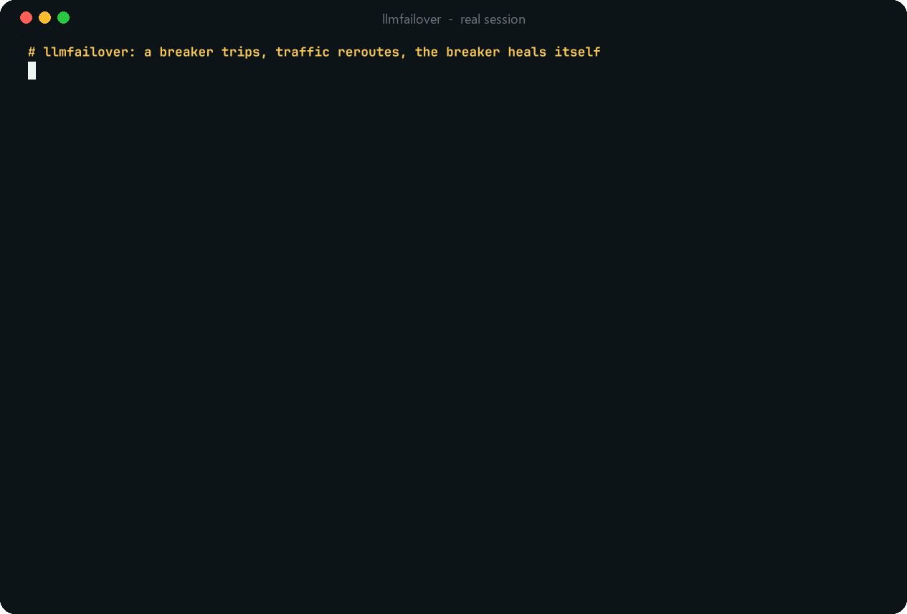
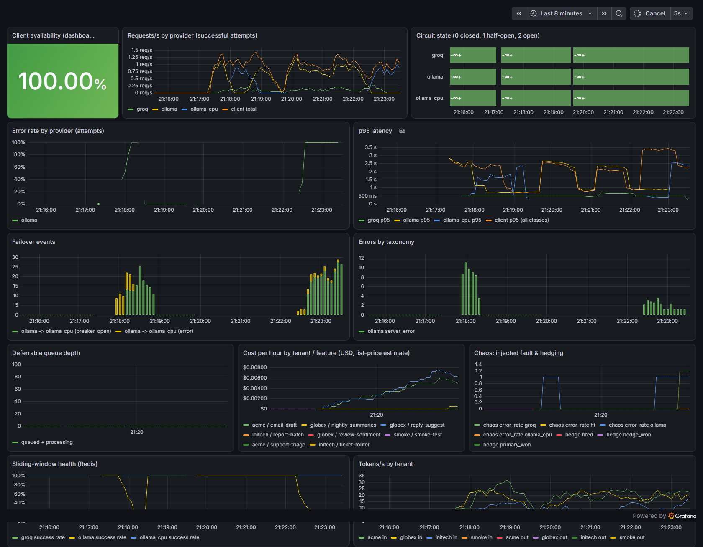
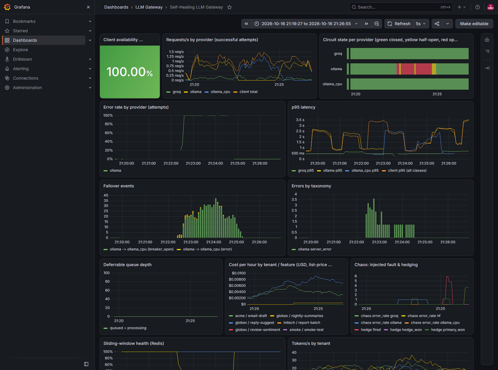
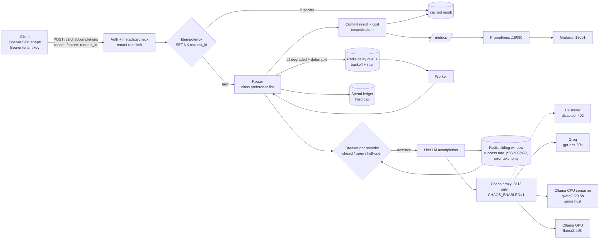
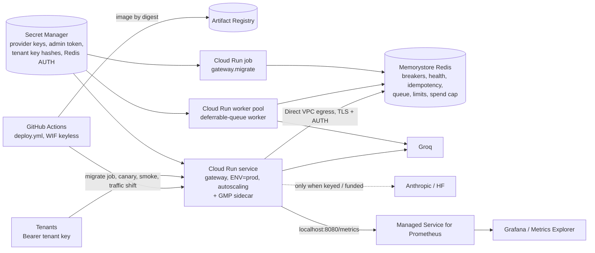

<p align="center">
  <picture>
    <source media="(prefers-color-scheme: dark)" srcset="assets/brand/logo-dark.svg">
    
  </picture>
</p>

<p align="center">
  <b>When an LLM provider goes down, your requests route around it.</b><br>
  An OpenAI-compatible gateway with Redis-shared circuit breakers, half-open self-healing, hedging,
  idempotency keys, a deferrable queue and per-tenant cost attribution. Proven by chaos runs.
</p>

<p align="center">
  
  <br><sub>A real session against the local stack, at real speed. <a href="assets/demo/README.md">What was real and how it was recorded</a>.</sub>
</p>

<p align="center">
  <a href="https://github.com/niravpatidar37/llmfailover/actions/workflows/ci.yml"></a>
  <a href="LICENSE"></a>
  
</p>

> **Status: working MVP, measured on one laptop.** In a chaos run where **both local model runtimes went
> down for 90 s, clients still got answers for 83.9% of requests (80.0% of interactive ones)** by failing over
> to Groq, and four runs produced **0 duplicate side effects across 141 duplicate submissions**. The run with
> 100% availability failed over to a second runtime **on the same host**, so it is not an independent-failure
> claim. Cloud deployment is **deploy-ready, not applied** (no cloud account connected). Read
> [What did not work](#what-did-not-work) before relying on it.

## The problem

An application that calls one LLM provider inherits all of that provider's bad days, and naive retries make
them worse.

- **Providers fail and throttle.** Hosted APIs return 5xx during incidents and 429 when you exceed a quota;
  Groq's free tier, used here, is limited per model in requests and tokens per minute
  ([Groq rate limits](https://console.groq.com/docs/rate-limits)).
- **Retrying a sick dependency piles on load.** The circuit-breaker pattern stops calling a failing
  dependency and probes it before trusting it again ([Martin Fowler](https://martinfowler.com/bliki/CircuitBreaker.html));
  retries need backoff with jitter ([AWS Builders' Library](https://aws.amazon.com/builders-library/timeouts-retries-and-backoff-with-jitter/)).
- **Slow is the new down.** A few slow calls dominate tail latency; hedged requests cut it at a bounded
  cost ([Dean and Barroso, *The Tail at Scale*](https://research.google/pubs/the-tail-at-scale/)).
- **Client retries cause duplicate work.** Without idempotency keys a timed-out request that actually
  succeeded is executed again, and billed again ([Stripe](https://stripe.com/blog/idempotency)).

llmfailover puts those four patterns in one small gateway in front of several providers, keeps their state in
Redis so every instance agrees, and measures the result with a chaos proxy instead of asserting it.

## What it does

| | Behaviour | Where |
|---|---|---|
| **Failover** | Each request class has a provider preference list (`config/gateway.yaml`); the router walks it, skipping providers whose breaker is open. | `router.py` |
| **Circuit breakers** | Per provider: trip on error rate (≥ 50% over ≥ 4 samples) or on p95 over the latency budget; open 10 s, doubling per failed probe up to 30 s. | `breaker.py`, `health.py` |
| **Half-open self-healing** | After the cooldown, 20% of eligible traffic (max 2 in flight) probes the provider; 3 consecutive fast successes close the breaker. | `breaker.py` |
| **Shared state** | Breaker transitions, probe leases, health windows, rate limits, hedge budget and spend cap are atomic Lua scripts in Redis, so any number of instances share one view. | `breaker.py`, `store.py` |
| **Hedging** | `classify` fires a hedge on the next provider after 2.5 s; the loser is cancelled; at most 30 hedges/min. | `router.py` |
| **Idempotency keys** | `request_id` is claimed with `SET NX`, scoped per tenant and checked against a body fingerprint; duplicates get the stored answer (`X-Idempotent-Replay: true`), never a second execution. | `store.py`, `service.py` |
| **Deferrable queue** | When every provider for a deferrable class is degraded, the request is queued (HTTP 202) and retried with exponential backoff and jitter; poll `GET /v1/requests/{id}`. | `service.py` |
| **Cost attribution** | Cost per tenant and feature in Prometheus (`gateway_cost_usd_total`) and Redis (`GET /admin/costs`); a hard spend cap is checked before every paid call. | `service.py`, `spend.py` |
| **Chaos proxy** | Dev-only fault injection (error rate, status code, latency, duration) between the gateway and each provider; refuses to start in prod. | `chaos.py` |

Error taxonomy: `rate_limit`, `timeout`, `server_error`, `content_filter`, `auth`, `connection`, `bad_request`,
`budget`, `other`. Only health-relevant errors count toward a trip.

## Results (real runs, raw data in `results/`)

Four chaos runs used the same gateway, a Poisson load generator, real providers and the chaos proxy. Every row below comes from `results/summary.json`, which `scripts/analyze.py` builds from the raw per-request files (`results/*_run.json`).

**Read the failure domains before the numbers.** `ollama` (llama3.1:8b on the host GPU) and `ollama_cpu` (qwen2.5:0.5b in a Docker container on the same laptop) are two runtimes on **one host**. They are **not** independent failure domains: a power, network or host failure takes out both. The only independent provider that worked during these runs was **Groq** (`openai/gpt-oss-20b`). The Hugging Face router was the planned third provider, but this account returns HTTP 402 "no remaining credits" (see [What did not work](#what-did-not-work)). Only run D below measures availability across independent failure domains.

| run | fault injected (via chaos proxy) | window | requests | client availability | interactive availability | interactive p95 |
|---|---|---|---|---|---|---|
| **D. local host down** (`local_host_outage_run.json`) | `ollama` + `ollama_cpu` return 100% HTTP 503 for 90 s; Groq is the only fallback; 0.7 rps | baseline | 37 | 100% | 100% | 2832 ms |
| | | **during outage** | 56 | **83.93%** | **80.0%** | 2357 ms |
| | | after fault cleared, breakers still open | 27 | 33.33% | 21.74% | 1916 ms |
| | | after breakers closed | 58 | 98.28% | 97.87% | 8937 ms |
| A. GPU runtime down (`chaos_run.json`) | `ollama` 100% 503 for 120 s; same-host CPU fallback (not independent); 1 rps | baseline | 110 | 99.09% | 98.88% | 679 ms |
| | | during outage | 122 | 100% | 100% | 2330 ms |
| | | after fault cleared, breaker still open | 37 | 100% | 100% | 1817 ms |
| | | after breaker closed | 100 | 100% | 100% | 2899 ms |
| B. GPU brownout (`brownout_run.json`) | `ollama` +7000 ms latency, 0% errors, 120 s; 1 rps | during brownout | 114 | 100% | 100% | 2658 ms |
| C. everything down (`total_outage_run.json`) | `ollama` + `ollama_cpu` + `groq` 100% 503 for 60 s; 1 rps | during outage | 46 | 23.91% (all deferred work) | **0%** (fails fast, by design) | n/a |
| | | after fault cleared, breakers still open | 25 | 60.0% | 54.55% | 2351 ms |

Breaker timelines (seconds from the start of the fault, taken from the gateway's own transition log):

* **A (error outage):** `ollama` tripped on error rate at **+17.2 s**. Half-open probes failed at +31.9, +52.1, +84.4 and +118.1 s, with the cooldown doubling up to its 30 s cap. The fault cleared at +120 s, and the breaker **closed at +163.4 s, 43.4 s after recovery**, once 3 consecutive probes succeeded. 137 failover events in total.
* **B (brownout):** `ollama` tripped on **p95 over budget** at +14.2 s. Half-open probes were rejected as `probe_too_slow` twice, and the breaker closed **7.3 s** after the latency cleared.
* **C (everything down):** all three breakers opened within 6 s. Interactive requests failed fast with HTTP 503: the gateway never calls a provider whose breaker is open. **All 11 deferrable requests submitted during the outage were queued (HTTP 202) and completed after recovery**, the slowest after 75.9 s, through exponential backoff with jitter. This is the intended behaviour, not a failure.
* **D (local host down):** `ollama_cpu` tripped at +1.9 s and `ollama` at +15.1 s, and traffic moved to Groq (47 requests served by Groq during the outage). Groq then started returning **429s**, because its 8K tokens/min free-tier limit is shared with other projects on the same key. Groq's breaker opened at +97.5 s on `rate_limit`, which caused the 33% window right after the fault cleared. The `ollama` breaker closed 38 s after recovery (`ollama_cpu` at 63 s).

**Idempotency:** 141 duplicate submissions across the four runs: client retries after a success, plus 3% sent concurrently with the original. 136 got the identical cached completion. The other 5 were all in run C (everything down):
* 2 got a `202 queued` replay.
* 2 got a `409` conflict (original still in flight, or failed and released).
* 1 got a `503` because the original also failed.

**0 `request_id`s were committed more than once**, per the gateway's per-request commit counters (`/admin/side-effects`).

**Cost of the measurement runs:** $0.0058 total for this project, from the shared ledger (190 paid calls at list price, including 3 cancelled hedge losers charged worst-case). That is under the project's $1 cap.

### Dashboard screenshots (real, taken by `scripts/grafana_screenshot.py` during the runs)

| run A during outage | run A full window (taken after the run) |
|---|---|
|  |  |

More: `docs/grafana_brownout_during.png`, `docs/grafana_total_outage_during.png`, `docs/grafana_local_host_outage_during.png`.

### Resume line (filled from the runs above)
Built an LLM gateway with per-provider circuit breaking and automatic failover; sustained 83.9% client availability (80.0% interactive) through a 90-second outage of every local model runtime, failing over to an external provider, with 0 duplicate side effects across 141 retried requests and per-tenant/per-feature cost attribution.

## Quick start

```bash
uv sync                                   # Python 3.12 venv from uv.lock
uv run python scripts/init_env.py         # gitignored .env: random admin/chaos tokens + Grafana password
docker compose -p p3-gateway up -d        # redis :16380, prometheus :19090, grafana :13001, ollama-cpu :11435
docker exec p3-gateway-ollama-cpu-1 ollama pull qwen2.5:0.5b
# host Ollama with llama3.1:8b on :11434; GROQ_API_KEY in $PORTFOLIO_ENV_FILE

# gateway on 127.0.0.1:8103 (and, for chaos tests, the proxy on 127.0.0.1:8113)
CHAOS_ENABLED=1 uv run python -m gateway.chaos &
CHAOS_ENABLED=1 CHAOS_PROXY_URL=http://127.0.0.1:8113 uv run python -m gateway.app &

uv run python -m gateway.migrate         # versioned Redis keyspace migrations (/readyz is 503 until run)
uv run python scripts/smoke.py
uv run python scripts/loadgen.py --provider ollama,ollama_cpu --outage 90 --rate 0.7 --out results/local_host_outage_run.json
uv run python scripts/analyze.py          # -> results/summary.json
uv sync --group screenshot && uv run playwright install chromium && uv run python scripts/grafana_screenshot.py
uv run pytest -q                          # 117 tests; 17 need a real Redis (REDIS_TEST_URL), else skipped
docker compose -p p3-gateway stop
```

Example request (any OpenAI client works; the metadata can also be sent as `X-Tenant-Id`, `X-Feature`, `X-Request-Id` and `X-Request-Class` headers):

```bash
curl -s 127.0.0.1:8103/v1/chat/completions -H "Authorization: Bearer $TENANT_KEY" -d '{
  "messages":[{"role":"user","content":"Sentiment? great film"}],"max_tokens":4,
  "metadata":{"tenant":"acme","feature":"support-triage","request_id":"req-000123","request_class":"classify"}}'
```

Tenants are created with `POST /admin/tenants {"tenant":"acme","rpm":600}` and `X-Admin-Token`. The key is returned once.

To watch a breaker trip and heal in your terminal, with the stack above running:
`uv run python assets/demo/demo.py` (it calls Groq only when a hedge or failover reaches it; see
[assets/demo/README.md](assets/demo/README.md)).

## Architecture



* **Request classes** (`config/gateway.yaml`):
  * `classify`: interactive and hedged. Prefers `ollama` → `ollama_cpu` → `groq` → `hf`, and fires a hedge on the next provider after 2.5 s.
  * `generate`: interactive. Prefers `groq` → `ollama` → `ollama_cpu`.
  * `batch`: deferrable. Prefers local first, then the external providers.
* **Breaker rules:**
  * Trip when the error rate is ≥ 50% over ≥ 4 samples, or the p95 of successes exceeds the provider's latency budget. Only samples since the last state change count.
  * The first open lasts 10 s. Each failed probe doubles it, up to a 30 s cap.
  * Half-open admits 20% of eligible traffic, with at most 2 probes in flight. 3 consecutive fast successes close the breaker.
  * `content_filter`, `bad_request` and local budget refusals never trip a breaker, because they say nothing about provider health.
* **Error taxonomy:** `rate_limit`, `timeout`, `server_error`, `content_filter`, `auth`, plus `connection`, `bad_request`, `budget` and `other`. Classification checks the HTTP status before the exception class: LiteLLM 1.105.1 raises `BadRequestError` with `status_code=401` for a bad Groq key, and a plain `APIError(402)` for HF billing failures (`tests/test_components.py::test_status_code_beats_exception_class`).

## Design decisions (trade-offs)

1. **Provider #3: the HF router could not be used, so a second local runtime took its place, and it is not independent.**
   * **Gave up:** a third independent failure domain. Only Groq is external and working, so the independent-domain claim rests on run D alone, and `ollama` + `ollama_cpu` are never counted as two independent providers.
   * **Kept:** a third runtime that is separate at the process, VM and hardware level (GPU vs CPU). That is enough to exercise failover, hedging and recovery cheaply and repeatably.
   * **To fix:** add credits to HF (or another external provider) and set `HF_ENABLED=1`. The adapter and its 402 → `auth` mapping are already wired in.
2. **Traffic mix is mostly local, with a low paid rate.** About 90% of traffic prefers Ollama; `generate` (about 10%) prefers Groq. Load tests use 4-24 `max_tokens` and SST-2 one-liners (`scripts/prompts/sst2_validation_100.jsonl`, 100 real validation sentences).
   * **Gain:** all four runs cost $0.0058.
   * **Price:** the external fallback is a free-tier key shared with other projects. Run D shows it cannot absorb the full local load (429s at about 0.7 rps of gpt-oss traffic).
3. **Hedging only for `classify`, with a 2.5 s delay and a 30 hedges/min budget.**
   * **Cost:** hedging roughly doubles cost on every hedged call. The cancelled loser may still be billed, so a paid loser is written to the ledger at its worst-case estimate.
   * **Gain:** a slow primary no longer dominates tail latency.
   * **Finding:** the 2.5 s delay was too conservative. After recovery, hedged requests took about 2.6 s even though the hedge itself answered in about 100 ms. A delay near the primary's p95 (about 0.7-1.0 s at baseline) would cut the tail.
4. **Breaker state, transitions and probe admission live in Redis, so any number of gateway instances share one breaker.**
   * **Gain:** a restart keeps the provider-health view (`test_window_survives_new_tracker_instance`), and autoscaled instances agree. Every transition is one atomic Lua script: a trip is a compare-and-set on an `epoch` (two instances that see the same failures produce one transition), and half-open probes are lease tokens counted inside the script, so the in-flight probe cap holds across instances and processes (`tests/test_multi_instance.py`).
   * **Price:** each attempt costs Redis round trips (admit, record, judge), and Redis is now a hard dependency for routing. Probe leases expire after 60 s, so a crashed instance can block half-open probing for up to that long.
   * **History:** the chaos runs above used the earlier version (per-process locks and probe counters, one gateway process). Against that code, two instances admitted 4 probes where the cap is 2 (`results/deploy_ready_mutation_check.json`, `teeth_vs_main`).

## What did not work

* **Hugging Face Inference Providers:** every model and provider returned **HTTP 402 "no remaining credits"** for this non-PRO account (`results/hf_router_probe.json`). HF is configured but disabled by default (`HF_ENABLED`). Because of this, the gateway has one independent external provider instead of two, and the second local runtime (`ollama_cpu`) is a stand-in that shares the host's failure domain.
* **The shared Groq free tier limited failover capacity.** In run D, Groq served 47 requests during the outage and then hit 429s. Its breaker tripped on `rate_limit`, leaving nothing healthy for about 30 s right after the local fault cleared (33% availability in that window).
* **Recovery lag is a real cost.** Exponential probe cooldowns protect a sick provider, but they also keep healthy capacity unused after it recovers. In A the breaker closed 43 s after recovery. In C, 40-45% of requests failed in the window after the fault cleared but before breakers re-closed. Half-open probes come only from live traffic, so a fallback-only provider (`ollama_cpu` in C) can stay half-open indefinitely.
* **The host GPU Ollama is noisy.** Baseline p95 ranged from 0.68 s to 2.8 s between runs, and in runs C and D the `ollama` breaker tripped on p95 *before* any fault was injected (recorded as `breaker_trips_before_fault` in `results/summary.json`). Other workloads share the 6 GB GPU. The breaker did its job; the latency budget (6 s) may be too tight for this host.
* **One client `ReadError` in run A's baseline.** This is the classic keep-alive race: uvicorn's default 5 s keep-alive is shorter than an idle pooled client connection. It is now fixed (`timeout_keep_alive=75`); runs B-D used the fix.
* **The first total-outage attempt crashed** because the load generator started before the gateway finished importing LiteLLM. It now waits on `/healthz`; the re-run is what's reported.
* **Headline bookkeeping bug:** run C's raw `headline` reports a breaker trip at -49 s. That was a pre-fault p95 trip picked up by an early version of the loadgen summary. `scripts/analyze.py` recomputes the trip from events after the fault starts (fixed in the loadgen for later runs).
* **Grafana kiosk mode rendered empty time-series panels in headless Chromium.** The screenshot script uses the normal view.

* **In the recorded demo, the same-host CPU runtime lost every hedge race** (it answered slower than the 2.5 s
  hedge delay plus Groq), so outage traffic went to Groq. Not investigated further; details in
  [assets/demo/README.md](assets/demo/README.md).

## Security model

**Threat model.** Untrusted callers (tenants) and untrusted model output. The assets are the provider API keys, tenants' prompts (PII), cross-tenant results, and spend. Out of scope: a hostile host OS. Locally there is no TLS (localhost only); in the GCP deployment TLS terminates at Cloud Run and Redis traffic uses TLS + AUTH over the VPC.

| Control | Where | Proven by (fails if the control is removed) |
|---|---|---|
| Per-tenant API keys; only SHA-256 stored | `store.py` | `test_api_keys_stored_only_as_hashes` |
| Metadata tenant must equal the key's tenant (no spoofed cost attribution) | `app.py` | `test_tenant_spoofing_is_403` |
| Required metadata (tenant, feature, request_id) | `app.py` | `test_missing_metadata_rejected[*]` |
| Per-tenant sliding-window rate limit | `store.py` | `test_tenant_rate_limit` |
| Idempotency scoped per tenant; atomic `SET NX` claim; body-fingerprint check | `store.py`, `service.py` | `test_concurrent_duplicates_execute_once`, `test_idempotency_is_scoped_per_tenant`, `test_request_id_reuse_with_different_body_is_rejected`, `test_worker_skips_job_already_committed` |
| PII and secret redaction in request logs (twice: the record builder and a logging filter) | `redact.py`, `service.py` | `test_request_log_redacts_pii`, `test_redact_removes_pii[*]` |
| Hard spend cap (global $25, project $1), checked before each paid call | `spend.py`, `router.py` | `test_budget_exceeded_skips_paid_provider`, `test_ledger_caps_and_concurrent_appends` |
| Chaos proxy off unless `CHAOS_ENABLED=1`; admin token required; fixed upstream map (no SSRF) | `chaos.py` | `test_chaos_proxy_refuses_to_start_when_disabled`, `test_chaos_proxy_injects_and_clears_faults` |
| Bounded Prometheus label cardinality (features past 50 per tenant become `other`) | `store.py` | `test_feature_label_cardinality_is_bounded` |
| Admin endpoints need `X-Admin-Token` (constant-time compare) | `app.py` | `test_admin_endpoints_require_token` |
| Chaos can never run in prod: the gateway refuses to start with `ENV=prod` + `CHAOS_ENABLED=1` (or `CHAOS_PROXY_URL`), the chaos proxy refuses `ENV=prod` outright, and providers never route through the proxy in prod; the image defaults to `ENV=prod` | `config.py`, `chaos.py`, `Dockerfile` | `test_gateway_refuses_to_start_with_chaos_enabled_in_prod`, `test_chaos_proxy_refuses_to_start_in_prod_even_when_enabled`, `test_provider_never_routes_through_chaos_proxy_in_prod`, CI `docker` job |
| Prod fails closed on unsafe config: unknown `ENV`, local/private provider URLs (Ollama), file spend ledger, plaintext Redis, short admin token | `config.py` | `test_unknown_env_fails_closed[*]`, `test_prod_refuses_local_ollama_providers`, `test_prod_refuses_weak_settings[*]` |
| Breaker shared across instances: one transition per trip, bounded half-open probes in total, stale probe results ignored, dead instances' leases expire | `breaker.py` | `test_concurrent_trip_is_one_transition`, `test_half_open_admits_a_bounded_number_of_probes_in_total`, `test_probe_bound_holds_through_a_random_interleaving[*]`, `test_two_processes_share_the_probe_bound`, `test_two_gateway_apps_share_breaker_state_and_probe_bound`, `test_late_probe_result_from_previous_episode_is_ignored`, `test_trip_judged_on_a_stale_epoch_is_rejected`, `test_crashed_instance_probe_leases_expire` |
| Tenant rate limit, hedge budget and spend cap hold across instances (atomic Lua) | `store.py`, `router.py`, `spend.py` | `test_tenant_rate_limit_holds_across_instances`, `test_hedge_budget_window_is_shared`, `test_redis_spend_cap_holds_across_instances`, `test_spend_reservation_of_a_crashed_instance_expires` |
| Kill switch: env flag or Redis key stops every provider call; deferrable work is refused, queued jobs stay put | `router.py`, `service.py`, `store.py` | `test_kill_switch_env_flag_blocks_every_provider_call`, `test_kill_switch_admin_toggle_is_instant_and_reversible`, `test_worker_leaves_queue_untouched_while_kill_switch_engaged` |
| Tenant keys from Secret Manager (hashes only), overlap rotation and revocation; the admin API cannot mint keys in prod | `store.py`, `app.py` | `test_tenant_keys_from_secret_spec_authenticate_rotate_and_revoke`, `test_malformed_tenant_spec_fails_startup` |
| `/metrics` (tenant names, costs) off the public port in prod: served on `127.0.0.1:8080` for the sidecar only | `app.py` | `test_metrics_leave_the_public_port_when_metrics_port_is_set` |

**Mutation check:** each original control was broken one at a time and the tests re-run. **13 of 14 mutants were killed.** The survivor removed only the logging-filter redaction while the record builder still redacted. That is defence in depth by design; removing both is killed. The deploy-readiness controls (new rows above) got their own pass: **18 of 18 mutants killed**, run against fakeredis and a real Redis 7 (`results/deploy_ready_mutation_check.json`).

Other controls:
* Request bodies are capped (64 KB, 8000 prompt chars, 32 messages), and `max_tokens` is capped per class.
* `stream=true` is rejected.
* Model output is returned as data and never executed.
* Secrets come from the shared env file or a gitignored `.env` and are never logged.
* The container runs as non-root (uid 10001), and every port binds to 127.0.0.1.

**Residual risk:**
* `/metrics` is unauthenticated: localhost-only locally, and on a localhost-only port in Cloud Run. It exposes tenant names and costs to anything inside the instance.
* SHA-256 without a pepper is fine for 256-bit random keys but not for low-entropy ones.
* The chaos proxy forwards the gateway's provider `Authorization` headers. It is a localhost dev tool.
* Multi-instance behaviour is proven by tests (fakeredis, a real Redis 7 in CI, two OS processes), not by a load test on real Cloud Run.
* Prod is public at the Cloud Run edge (`public_invoker = true`) with app-level tenant-key auth; there is no load balancer / Cloud Armor in front.
* The Memorystore AUTH string is a GCP-generated attribute and therefore present in Terraform state. Restrict the state bucket.
* Regex redaction misses PII in unusual formats.

**OWASP LLM Top 10 (2025) mapping:**
* LLM02 Sensitive Information Disclosure: log redaction, per-tenant idempotency scoping.
* LLM10 Unbounded Consumption: rate limits, `max_tokens` caps, spend cap, hedge budget.
* LLM05 Improper Output Handling: output never executed or rendered.
* LLM03 Supply Chain: pinned deps in `uv.lock`, pip-audit, Trivy, actions pinned by SHA, LiteLLM version pinned and its API verified from installed source.
* LLM06 Excessive Agency: not applicable (no tools).
* LLM01 Prompt Injection: not mitigated. A gateway passes prompts through; it is the application's job.

## Cost

* **Actual spend for this project (shared ledger, 2026-10-18):** **$0.0081 over 277 paid Groq calls**, at
  estimated list prices ($0.10 per 1M input and $0.50 per 1M output tokens, higher than Groq's current published
  price, so the cap errs safe). Of that, $0.0058 (190 calls) covers development probes, the four chaos runs and
  one dry run, and $0.0024 (87 calls) covers the four takes of the demo recording.
* **Local Ollama:** $0.
* **Attribution:** the gateway attributes cost per tenant and feature in Prometheus (`gateway_cost_usd_total`) and in Redis (`GET /admin/costs`). The dashboard shows cost per hour by tenant and feature.

## Deployment

**Status: deploy-ready; not applied (no cloud account connected).** Target: Google Cloud Run, provisioned by
Terraform. Docs: [docs/RUNBOOK.md](docs/RUNBOOK.md) (bootstrap, deploy, verify, rollback, secret rotation,
kill switch, incidents) and [docs/SLO.md](docs/SLO.md) (SLIs/SLOs and a monthly cost estimate, ≈ $170 prod /
≈ $62 staging plus capped LLM spend; an estimate from GCP list prices).



What is in the repo:

| Piece | Where |
|---|---|
| Terraform module + `envs/staging`, `envs/prod` (tfvars, pinned `hashicorp/google` 8.7.0, committed `.terraform.lock.hcl`, GCS backend via `-backend-config`) | `infra/terraform/` |
| Cloud Run v2 **service** (API): min/max instances, CPU/memory, concurrency 40, startup probe `/readyz`, liveness `/healthz`, ingress, GMP sidecar | `modules/gateway/run.tf` |
| Deferrable-queue worker as a Cloud Run **worker pool** (`google_cloud_run_v2_worker_pool`, present in provider 8.7.0; always on, manual scaling, no ingress) | `modules/gateway/run.tf` |
| Migrations: numbered modules in `src/gateway/migrations/`, applied by the Cloud Run **job** `gateway.migrate` before each rollout, never at import | `modules/gateway/run.tf`, `src/gateway/migrate.py` |
| Memorystore for Redis (STANDARD_HA in prod, BASIC in staging), private IP, AUTH, TLS, reached through **Direct VPC egress** (no connector) | `modules/gateway/network.tf` |
| One service account per role (api, worker, migrate) with secret-level grants; deploy SA gets only run.developer, actAs on those SAs, run.invoker and AR writer | `modules/gateway/iam.tf` |
| Secret Manager secrets created **empty**; values are added with `gcloud secrets versions add` | `modules/gateway/main.tf`, RUNBOOK §2 |
| CD: build once, deploy the digest to staging (migrate, no-traffic canary, smoke `/healthz` + `/readyz`, promote), then prod behind the `production` environment approval (canary 10%, soak, 100%), automatic rollback | `.github/workflows/deploy.yml`, `scripts/smoke_deploy.sh` |
| CI: `terraform fmt -check`, `init -backend=false` + `validate`, tflint (terraform + google rulesets), checkov (one inline-justified skip: CMEK for Artifact Registry) | `.github/workflows/ci.yml` |

**One-time GCP bootstrap** (exact commands in RUNBOOK §1-2): create a GCS state bucket; create a Workload
Identity pool + OIDC provider restricted to this repository and a `gh-deploy` service account; set the repo
variables `GCP_PROJECT_ID`, `GCP_REGION`, `GCP_WIF_PROVIDER`, `GCP_DEPLOY_SA`; create the `staging` and
`production` environments (required reviewer on `production`); `terraform apply` the registry, secrets and
Redis; add secret versions; push a first image; apply the rest. Until `GCP_PROJECT_ID` is set, every deploy job
is skipped and the workflow passes.

**Prod differs from the measured setup (honest):**
* **Fewer independent providers.** Prod uses `config/gateway.prod.yaml`: external providers only. Ollama (GPU host
  and CPU container) is local/dev only, and the gateway refuses to start in prod with a local/private provider
  URL. Today only Groq is keyed, so prod has **one** provider and **no failover target**: when Groq's breaker
  opens, interactive requests fail fast (503) and deferrable ones queue. Anthropic turns on when
  `ANTHROPIC_API_KEY` exists and its placeholder model id is verified; HF when the account is funded (402).
  The availability numbers in the Results table do not transfer to this configuration.
* **Autoscaling** (prod `min 1 / max 10`, staging `0 / 3`) relies on the Redis-shared breaker, limits and spend
  cap. That is proven by tests that run two gateway instances (and two OS processes) on one Redis in CI, not by
  a load test on Cloud Run. Set `max_instances = 1` to fall back to a single instance.
* **Spend cap** in prod is a monthly per-project cap enforced atomically in Redis (`SPEND_BACKEND=redis`); the
  shared local JSONL ledger is dev-only. A Redis data loss resets the month's counter; the per-call JSON logs in
  Cloud Logging are the durable record.
* **Observability:** Google Cloud Managed Service for Prometheus via the documented Cloud Run sidecar
  (`cloud-run-gmp-sidecar:1.2.0`, default config scraping `localhost:8080/metrics`). The Grafana dashboard JSON
  now takes a `datasource` variable, so it works on the local Prometheus and on a GMP-backed Grafana data source.
  Worker-pool metrics are not exported in GCP (the sidecar is documented for services/jobs); queue depth is
  still reported by the API instances.

**Deploy-ready (built and checked in CI)** vs **assumed (not verified without a project):**

| Deploy-ready | Assumed / not verified |
|---|---|
| Terraform validates against `hashicorp/google` 8.7.0 schemas; tflint and checkov clean | that `terraform apply` succeeds first time (quotas, org policies such as `invoker_iam_disabled`, API enablement timing) |
| App: `/healthz` vs `/readyz`, graceful shutdown, env-only config, JSON logs, migrations job, kill switch, prod guards, Secret Manager tenant keys (all tested) | `gcloud run deploy --container`, `gcloud run worker-pools deploy` and the identity-token audience behave exactly as scripted in `deploy.yml` |
| Image refuses prod + chaos (CI docker job) | GMP sidecar CPU sizing (1 vCPU is conservative), and that the default scrape config is enough |
| Shared breaker semantics on real Redis 7 (CI service container) | Memorystore TLS/AUTH connection details from Cloud Run (server CA via `REDIS_CA_CERT_PEM`) |

## Project layout

```
src/gateway/           app (FastAPI), router, breaker, health windows, store (Redis), service, queue worker,
                       spend cap, chaos proxy, config, redaction, migrations/
config/                gateway.yaml (dev providers + classes), gateway.prod.yaml (external providers only)
scripts/               loadgen.py (chaos runs), analyze.py (-> results/summary.json), smoke.py, init_env.py,
                       make_tenant_key.py, grafana_screenshot.py, smoke_deploy.sh
results/               raw per-request chaos runs, summary.json, HF 402 probe, mutation-check results
tests/                 117 tests: unit, API, security controls, multi-instance (fakeredis, real Redis, 2 processes)
deploy/                Prometheus config and the provisioned Grafana dashboard
infra/terraform/       Cloud Run module + envs/staging, envs/prod
docs/                  RUNBOOK.md, SLO.md, Grafana screenshots from the runs
assets/brand/          logo, icons, favicon, social preview + build_brand.py
assets/demo/           demo.gif, demo.cast, demo.py (scenario), record.py (cast recorder), frame.py
```

## Part of a portfolio

Five LLM-engineering projects built to the same bar (real runs, committed raw results, a shared hard spend cap,
CI with security scans, deploy-ready Terraform):

| Repo | What it is |
|---|---|
| [hopcite](https://github.com/niravpatidar37/hopcite) | Graph RAG with cited multi-hop answers |
| [tracedresearch](https://github.com/niravpatidar37/tracedresearch) | LangGraph multi-agent research assistant with cited reports and per-step traces |
| **llmfailover** | this repo: the reliability layer between apps and model providers |
| [kappajudge](https://github.com/niravpatidar37/kappajudge) | LLM-as-a-judge calibrated against human ratings (weighted kappa, bias checks) |
| [distillroi](https://github.com/niravpatidar37/distillroi) | Distils a large teacher into a QLoRA student served by vLLM, with a router that escalates hard queries |

They share the spend-ledger design and the Groq + Ollama setup; none of them routes through this gateway today.

## License

MIT, see [LICENSE](LICENSE). Brand assets: [assets/brand/README.md](assets/brand/README.md).
